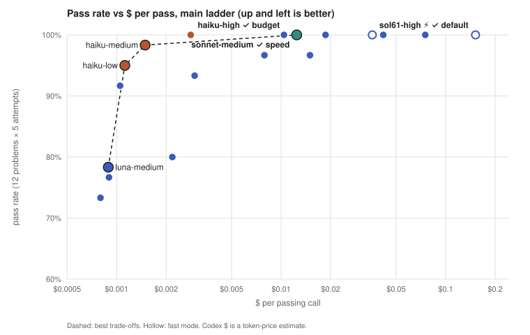

# DispatchBench

LeetCode-style problems, written fresh for this bench.

**[Interactive report](results/report/page.html)** · [Full report](docs/REPORT.md) · [Raw data](results/) · [Reproduce](#reproduce) · [Cite](#cite)



Which model and reasoning effort should a coding task be routed to? This repo measures 6 Claude Code and Codex CLI configs, plus 5 Codex configs added on 2026-10-23, on 15 Python problems written after the models' training cutoff, plus 4 small repo tasks.

## The answer

Claude and Codex are billed separately, so the table shows both: Claude $ is Claude CLI-reported cost (list basis); Codex $ is a token-price estimate. The list $ column combines those two accounting bases.

| Route to | When | Passed | Claude $ per pass | List $ per pass | Median s |
|---|---|---|---|---|---|
| **sol61-high**, haiku-low repairs only if a check fails | default while Codex has quota | 60/60 | $0 | $0.019 | 27.4 |
| astra-medium, same repair | faster, about 4.0× the list price (Codex usage assumed to track it) | 60/60 | $0 | $0.075 | 20.9 |
| haiku-low | Codex out | 57/60 | $0.0011 | $0.0011 | 10.0 |
| haiku-high | Codex out and a miss is costly (exploratory) | 60/60 | $0.0028 | $0.0028 | 14.7 |

Main ladder: 12 problems × 5 attempts per config.

- **Trust first, then save.** A cheap model plus a Haiku reviewer costs more than haiku-medium alone, because Haiku redoes the work. Savings come only from a builder that is right on its own.
- **sol61-high and astra-medium never failed**: every main-ladder attempt, every attempt on the hardest rung, and all 12 repo-task runs. With the Haiku repair gated on the statement's examples, they needed 0 and 0 repairs on luna's hardest problems (35/35 and 35/35).
- **The price is time.** On the repo tasks they take 118 s and 66 s at the median, against about 28 s for haiku-low and sonnet-medium.
- **Skip luna at low or medium effort.** It barely reasons there and misses easy problems. luna-high does better but still misses some.
- **Fast mode (⚡) keeps the passes and costs about twice as much per pass.** sol61-high ⚡: 60/60, 17.4 s against 27.4 s; astra-medium ⚡: 60/60, 9.9 s against 20.9 s. Neither missed on L7 (15/15, 15/15).
- **haiku-high and sonnet-medium also never failed.** haiku-high: 60/60, 15/15 on L7 and 12/12 repo tasks at $0.0028 per pass, 7× cheaper than sol61-high and faster (14.7 s against 27.4 s). haiku-medium still misses (13/15 on L7). sonnet-medium: 75/75, the fastest of them.

Function + agentic spend only (auxiliary runs and pilot excluded): $2.46 Claude, $36.27 Codex at list prices ($17.52 of it for the Codex models added on 2026-10-23, $16.28 for the fast-mode and xhigh runs).

## Read more

- **[Interactive report](results/report/page.html)**: charts and sortable tables in one self-contained HTML file. Download it and open it in a browser.
- **[Full report](docs/REPORT.md)**: method, every table, the appendices, limitations.
- **[Every model answer](results/solutions/README.md)**: per problem, with a short note on the problem and the correct approach, so you can judge the code.
- **[Pre-registration](PLAN.md)**: what was planned before any model call, and each deviation.
- Raw data: `results/*.jsonl`; prices: [results/prices.json](results/prices.json).

## Reproduce

```bash
git clone https://github.com/chimera-defi/dispatchbench.git && cd dispatchbench
make report && make audit
```

This rebuilds every table, chart and page from the committed cache. It makes no model calls. Needs Python and make; `pip install -r requirements.txt` adds pytest for `python3 -m pytest tests`.

## Add a model

1. Add a line to `CONFIGS` in `bench/run.py`: name → (CLI, model id, effort).
2. Register it with `add(...)` in `analysis/configs.py`. A Codex model also needs its price in `results/prices.json`.
3. Run `python3 -m bench.run --phase exploratory --configs <name>`. This makes real model calls and spends money.
4. Run `make grade && make report && make audit`. The audit names anything left to wire up.

The grader runs model-written code with CPU and memory limits only, not network or file isolation. Grade new code in a container or VM.

## For agents

- `README.md`, `docs/REPORT.md` and `results/report/page.html` are generated. Edit `docs/readme.tmpl.md`, `docs/report.tmpl.md` or `docs/page.tmpl.md`, then run `make report && make audit`.
- Every number in a template is a fact computed in `analysis/report.py`. A bare number fails `make audit` unless `docs/audit_allow.json` lists it.
- `make report` makes no model calls. New runs go through `bench/run.py` (cache-first, with a Claude spend cap).
- Repo layout: the Layout section of [docs/REPORT.md](docs/REPORT.md).

## Cite

Cite as: DispatchBench (2026), github.com/chimera-defi/dispatchbench. Metadata: [CITATION.cff](CITATION.cff).

MIT licence, see [LICENSE](LICENSE).
