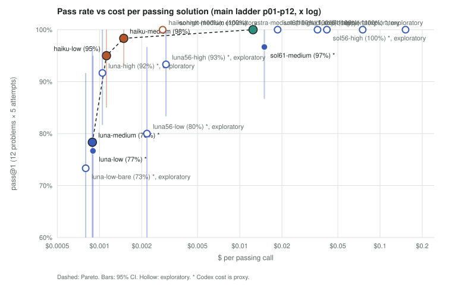
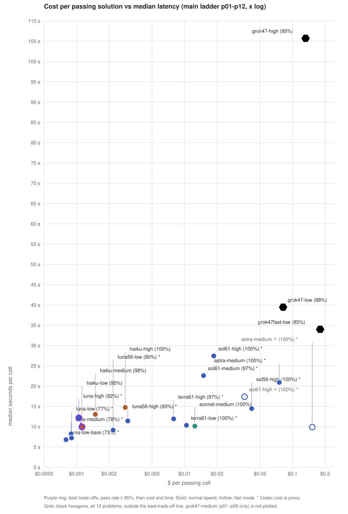
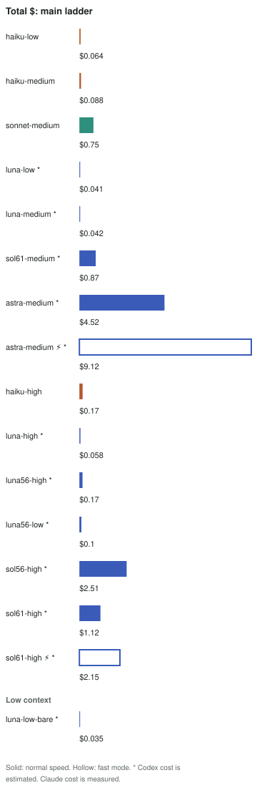
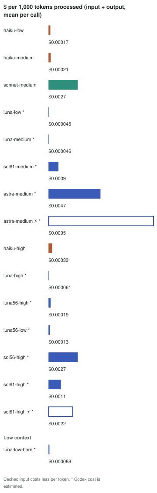
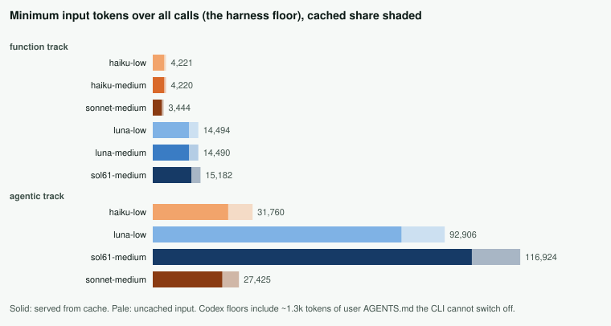
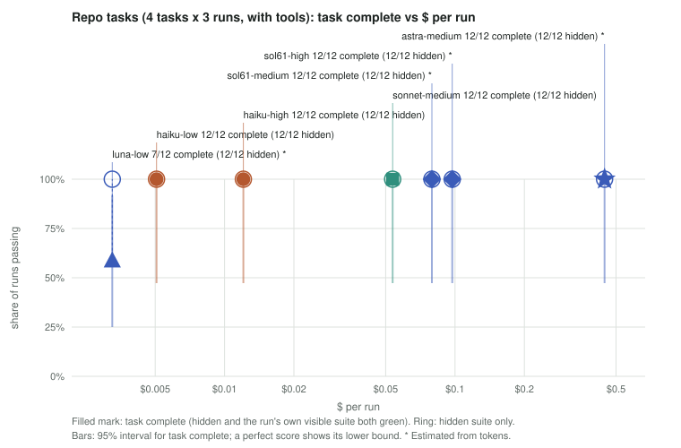

# model-routing-bench: full report

Short version: [README](../README.md). Interactive version: [results/report/page.html](../results/report/page.html).

Which model and reasoning effort should a coding task be routed to? This repo measures 6 Claude Code and Codex CLI configs on 12 Python problems written after the models' training cutoff, plus 4 small repo tasks. For each config it records where pass rate drops, and what a passing answer costs in dollars and seconds.

The main run was on 2026-10-22: $2.06 of measured Claude spend and $8.11 of Codex usage priced at list rates. Five more Codex configs were added on 2026-10-23 for $11.01 (finding 5). Every number on this page is regenerated by `make report` from the cached calls, with no model calls, and `make audit` fails if any of them disagrees with the data.

> **Routing rule these numbers support:** send to haiku-medium by default: 59/60 on all problems, $0.00149 per pass, and no miss on luna-low's hardest problems (its main-run attempts there), where it is 1.8× cheaper than the best luna→Haiku pipeline (Appendix A). On a tight budget, haiku-low (95%, $0.00112 per pass) misses only by being slow or crashing. Do not rely on luna at low or medium effort: it already fails an L2 problem, and at those settings it barely reasons. sonnet-medium is the cheapest config by list price that never failed (75/75 including L7), at about 11× haiku-low's price per pass. Counting only Claude dollars, the pick is a Codex config that never failed, sol61-high (finding 5): $0 on the Claude bill, at the cost of Codex usage and time.

## Result

| config | pass@1 | 95% CI | median s | p90 s | $ per pass | total $ (60 calls) | $ kind |
|---|---|---|---|---|---|---|---|
| haiku-low | 95% (57/60) | 85%–100% | 10.0 | 16.0 | 0.00112 | 0.064 | measured |
| haiku-medium | 98% (59/60) | 93%–100% | 13.0 | 26.8 | 0.00149 | 0.088 | measured |
| sonnet-medium | 100% (60/60) | ≥78% (all passed) | 10.1 | 18.1 | 0.01244 | 0.746 | measured |
| luna-low | 77% (46/60) | 53%–95% | 7.2 | 11.6 | 0.00090 | 0.041 | proxy |
| luna-medium | 78% (47/60) | 57%–97% | 8.2 | 11.8 | 0.00089 | 0.042 | proxy |
| sol61-medium | 97% (58/60) | 87%–100% | 22.6 | 36.2 | 0.01499 | 0.869 | proxy |
| astra-medium (exploratory) | 100% (60/60) | ≥78% (all passed) | 20.9 | 35.6 | 0.07526 | 4.516 | proxy |
| luna-high (exploratory) | 92% (55/60) | 82%–100% | 12.2 | 22.9 | 0.00105 | 0.058 | proxy |
| luna-low-bare (exploratory) | 73% (44/60) | 52%–92% | 6.8 | 11.1 | 0.00080 | 0.035 | proxy |
| luna56-high (exploratory) | 93% (56/60) | 83%–100% | 11.4 | 35.5 | 0.00298 | 0.167 | proxy |
| luna56-low (exploratory) | 80% (48/60) | 60%–97% | 9.2 | 17.4 | 0.00218 | 0.105 | proxy |
| sol56-high (exploratory) | 100% (60/60) | ≥78% (all passed) | 14.5 | 48.4 | 0.04180 | 2.508 | proxy |
| sol61-high (exploratory) | 100% (60/60) | ≥78% (all passed) | 27.4 | 50.2 | 0.01861 | 1.117 | proxy |

Function track: 12 problems × 5 attempts per config. Click a column header on the page version to sort. "$ per pass" is total spend divided by passing attempts. Claude dollars are the CLI's reported `total_cost_usd`; Codex dollars are token counts times list price ([results/prices.json](../results/prices.json)), a proxy. The exploratory rows were added after the main run: luna-high is luna at high effort on all 12 problems, luna-low-bare is luna-low with the Codex harness stripped to its smallest prompt (next section), and the other five are later Codex models (finding 5).

## Can luna run on fewer tokens?

Codex has no single switch like Claude's `--tools ""`. Turning off its tool features, shell tools, environment context and stock system prompt, six config knobs in all, cuts luna-low's mean input from 14,688 to 6,144 tokens per call, 58% less. No measurable change in accuracy: the stripped config passes 73% against stock luna-low's 77% (−3.3 pts, CI −20.0 to +13.3, which rules out neither a gain nor a loss). Its proxy cost per pass falls from $0.00090 to $0.00080.

Even stripped, luna's input is larger than Claude's with tools off: haiku-low's mean is 4,498. About 1.3k (estimated from file size) of luna's remaining tokens are the host's user-level `~/.codex/AGENTS.md`, which no Codex flag removes. Removing it needs a separate Codex home directory with its own copy of the login file, which this run did not do.


## What it found

1. **"Low effort" is not the same budget on both CLIs, and on the point estimates that explains most of luna's gap.** At low and medium effort luna emits a mean of 0 and 7 reasoning tokens per call; haiku-low emits about 1,030. At those settings luna passes 77% and 78%, and haiku-low passes 95% (paired difference +18.3 pts, CI +1.7 to +38.3). At high effort luna emits about 530 reasoning tokens and passes 92% (55/60), 3.3 pts below haiku-low (CI −13.3 to +6.7). Its cost per pass, $0.00105, is close to haiku-low's $0.00112, and its median latency is 12.2 s against 10.0 s.
2. **Luna's misses at low and medium effort cluster on three problems.** Together they pass 2/10 attempts on p04 (L2), 6/10 on p11 (L6) and 0/10 on p12 (L6). The pre-registered escalation re-ran those three at high effort: 13/15 against luna-medium's 3/15. The three were chosen because luna failed them, so that ratio overstates the general gain; the full-ladder luna-high run is the unbiased version (+13.3 pts against luna-medium, CI −5.0 to +35.0).
3. **Stripping the Codex harness halves luna's input but does not make it as accurate as Haiku.** On the full ladder stripped luna passes 73% against haiku-low's 95%: −21.7 pts, CI −43.3 to 0.0, so the interval's upper end touches zero. Its cost per pass, $0.00080, depends on Codex's prompt cache: with no input served from cache it would be $0.00120, 7% above Haiku's measured $0.00112 (which includes Claude's own cache discount).
4. **The repo tasks did not separate the configs.** The four configs first run passed every hidden test, 12/12 runs each (so did the two added later, finding 5). What differs is cost per run: luna-low $0.0040, haiku-low $0.0051, sonnet-medium $0.054, sol61-medium $0.075, a 19× spread for the same outcome. sol61-medium also took 89 s at the median against about 28 s for the other three. Part of the Codex cost and time comes from the host's `AGENTS.md`, which Codex loads and which tells the agent to look for more `AGENTS.md` files and to run a search helper and a review delegate. Commands that do one of those, or clean up after the delegate, account for 57 of sol61's 97 shell commands and 26 of luna's 62. The Codex agentic numbers are therefore upper bounds for a clean install.

5. **Two later Codex configs never failed, and they move the cost to the Codex bill** (exploratory, added 2026-10-23). sol61-high (gpt-6.1-sol at high effort) and astra-medium (gpt-6-astra) passed every L1–L6 attempt (60/60, 60/60), every L7 attempt (15/15, 15/15) and all 12 repo-task runs. On luna's hardest problems, with haiku-low repairing only when the statement's examples fail, they needed 0 and 0 repairs (35/35, 35/35), so their Claude cost there was $0.00000 and $0.00000 per pass. By list price they are dear: $0.0186 and $0.0753 per pass on L1–L6, 1.5× and 6× sonnet-medium's. astra-medium is faster (20.9 s against 27.4 s on L1–L6, 85 s against 109 s on the repo tasks) and uses about 4.0× as much at list price; both are much slower than a Claude builder on the repo tasks (about 28 s for haiku-low and sonnet-medium).
6. **The other later Codex configs change nothing.** sol56-high (gpt-5.6-sol) never fails on L1–L6 but misses on L7 (13/15) at 28× haiku-medium's price per pass. The older luna is worse and dearer: luna56-high passes 9/15 on L7 against gpt-6 luna-high's 15/15, and costs 2.8× as much per pass on L1–L6 (gpt-5.6-luna lists at twice gpt-6-luna's input price and more than twice its output price). Findings 5 and 6 are exploratory: the configs were chosen after the main results were known, and Codex dollars are list-price proxies.









| config | mean input | of which cached | mean output | of which reasoning | $ per 1k tokens |
|---|---|---|---|---|---|
| haiku-low | 4,498 | 3,875 | 1,805 | 1,027 | 0.00017 |
| haiku-medium | 4,497 | 3,915 | 2,620 | 1,836 | 0.00021 |
| sonnet-medium | 3,719 | 3,095 | 964 | 292 | 0.00266 |
| luna-low | 14,688 | 11,520 | 514 | 0 | 0.00005 |
| luna-medium | 14,688 | 11,520 | 530 | 7 | 0.00005 |
| sol61-medium | 15,380 | 12,346 | 718 | 209 | 0.00090 |
| astra-medium (exploratory) | 15,319 | 12,207 | 639 | 127 | 0.00472 |
| luna-high (exploratory) | 14,688 | 11,520 | 1,060 | 526 | 0.00006 |
| luna-low-bare (exploratory) | 6,144 | 3,255 | 528 | 0 | 0.00009 |
| luna56-high (exploratory) | 12,962 | 10,240 | 1,693 | 1,147 | 0.00019 |
| luna56-low (exploratory) | 12,965 | 10,281 | 835 | 295 | 0.00013 |
| sol56-high (exploratory) | 14,504 | 11,315 | 1,226 | 668 | 0.00266 |
| sol61-high (exploratory) | 15,380 | 12,083 | 1,081 | 565 | 0.00113 |





All tables, including outcomes (wrong / crash / timeout), per-rung counts and the pre-registered hypotheses, are in [results/report/tables.md](../results/report/tables.md). Four of the five hypotheses did not hold; that file says which and why.

### Codex harness floor

Each trim level adds Codex CLI 0.163.0 config knobs to the one before. The probe is one call per level on a trivial problem, at low effort, so these are single-call minimums rather than the means above.

| model | stock harness | + no project docs | + no env/permission context | + tool features off | + one-line system prompt | + shell tools off |
|---|---|---|---|---|---|---|
| gpt-6-luna | 14,389 | 14,389 | 14,210 | 9,930 | 6,485 | 5,845 |
| gpt-5.6-terra | 14,201 | 14,197 | 14,020 | 9,469 | 5,928 | 5,288 |

gpt-5.6-terra at the smallest prompt costs $0.0080 per call on the pilot problems, about 29× haiku-low, so it was not run on the full ladder.

## Code quality

Pass/fail stays the headline. These columns describe the passing solutions only, measured by `make quality` with no model calls; every solution is on disk under [results/solutions/](../results/solutions/README.md) (1166 files, one table per problem with links), so each number can be checked by hand. The factors and how they are measured are in PLAN.md (deviation 17). None of them is folded into a single score.

| config | passing solutions | median LOC | median max complexity | lint warnings per solution | median time vs reference | growth worse than reference | median peak memory vs reference |
|---|---|---|---|---|---|---|---|
| haiku-low | 57 | 38 | 11 | 0.11 | 1.13 | 3 | 1.00 |
| haiku-medium | 59 | 46 | 10 | 0.15 | 1.10 | 2 | 1.00 |
| sonnet-medium | 60 | 46 | 14 | 0.25 | 1.05 | 4 | 0.99 |
| luna-low | 46 | 37 | 9 | 0.13 | 1.12 | 4 | 1.00 |
| luna-medium | 47 | 47 | 14 | 0.09 | 1.10 | 6 | 1.00 |
| sol61-medium | 58 | 38 | 14 | 0.00 | 1.08 | 0 | 1.00 |
| luna-high | 55 | 39 | 9 | 0.00 | 1.13 | 2 | 1.00 |
| luna-low-bare | 44 | 37 | 11 | 0.11 | 1.13 | 6 | 1.00 |

Medians are over each config's passing L1–L6 solutions, so a config that fails p12, whose solutions are the longest, has a smaller median LOC for that reason alone. "Growth worse than reference" counts solutions whose fitted time exponent is more than 0.3 above the reference's on the same inputs. The medians hide per-problem patterns: on p08, 9 passing solutions from 5 configs run 29× to 38× slower than the reference at the largest size, because the reference runs in near-constant time (fitted exponent 0.03) and theirs grow with the input. Per-problem rows are in each problem's table under results/solutions/.

**Repo tasks.** Every task asked for a regression test. Whether the requested test file exists is checked by the harness after each run. The function counts come from the agents' own transcripts; Codex logs list the test files it touched but not always their contents, so its function counts are lower bounds.

| config | hidden tests passed | runs that wrote the requested test file | test functions added | median s | $ per run | $ kind |
|---|---|---|---|---|---|---|
| luna-low | 12/12 | 12/12 | ≥5 | 28.5 | 0.0040 | proxy |
| haiku-low | 12/12 | 12/12 | 114 | 28.3 | 0.0051 | measured |
| sonnet-medium | 12/12 | 12/12 | 77 | 27.7 | 0.0537 | measured |
| sol61-medium | 12/12 | 12/12 | ≥8 | 89.0 | 0.0752 | proxy |
| sol61-high | 12/12 | 12/12 | 0 | 108.6 | 0.0948 | proxy |
| astra-medium | 12/12 | 12/12 | 0 | 85.2 | 0.3798 | proxy |



## Harder rung (L7), added after the main run

Three more problems, written and checked before any model saw them (PLAN.md, deviation 16), each harder than p12: a cellular automaton on a ring run for up to 10^18 steps (p13), exact expected turns on a board game with bounce-back and chained jumps (p14), and paint/erase operations on 10^9 cells (p15). 5 attempts per config: the four original configs first, then the five later Codex models. These rows are kept apart from L1–L6 and change no number above.

| config | passed | 95% CI | p13 | p14 | p15 | median s | mean reasoning tokens | $ per pass | $ kind |
|---|---|---|---|---|---|---|---|---|---|
| astra-medium | 15/15 | ≥37% (all passed) | 5/5 | 5/5 | 5/5 | 30.6 | 315 | 0.0830 | proxy |
| luna-high | 15/15 | ≥37% (all passed) | 5/5 | 5/5 | 5/5 | 24.0 | 1,569 | 0.0015 | proxy |
| sol61-high | 15/15 | ≥37% (all passed) | 5/5 | 5/5 | 5/5 | 52.7 | 1,151 | 0.0236 | proxy |
| sol61-medium | 15/15 | ≥37% (all passed) | 5/5 | 5/5 | 5/5 | 35.2 | 482 | 0.0170 | proxy |
| sonnet-medium | 15/15 | ≥37% (all passed) | 5/5 | 5/5 | 5/5 | 15.0 | 806 | 0.0180 | measured |
| sol56-high | 13/15 | 53%–100% | 5/5 | 3/5 | 5/5 | 41.0 | 1,435 | 0.0685 | proxy |
| haiku-low | 12/15 | 40%–100% | 5/5 | 5/5 | 2/5 | 16.5 | 2,506 | 0.0023 | measured |
| luna56-high | 9/15 | 33%–87% | 4/5 | 2/5 | 3/5 | 20.7 | 2,605 | 0.0078 | proxy |
| luna56-low | 8/15 | 27%–80% | 3/5 | 2/5 | 3/5 | 11.6 | 761 | 0.0046 | proxy |

- **Of the four configs first run on L7, only haiku-low failed, and only on speed.** All 3 misses are timeouts on the same p15 case: 50,000 single cells painted with a high colour, then 50,000 paints across the whole strip. The failing solutions keep a sorted list of coloured intervals and visit every interval a paint covers, which is quadratic on that case; the 2 passing attempts used a segment tree. None of haiku-low's answers was wrong.
- **The other three did not separate.** With three problems, a perfect score only bounds the pass rate at ≥37% (one-sided 95%), so this says L7 is still not hard enough for them, not that they are equally strong. What does separate them is price and time: luna-high costs $0.0015 per pass (proxy) against $0.017–0.018 for sol61-medium and sonnet-medium, and sonnet-medium is the fastest at 15 s.
- Both effort-adaptive configs spent more reasoning on L7 than on L1–L6: haiku-low 2.4× (1,027 → 2,506 tokens), luna-high 3.0× (526 → 1,569).

## Where they fail

Every problem with at least one failure, over all phases. Cells are passes out of 5 (bold when 2 or fewer), then the failures: w wrong answer, c crash, t timeout. A dash means not run.

| problem | haiku-low | haiku-medium | sonnet-medium | luna-low | luna-medium | sol61-medium | astra-medium | luna-high | luna-low-bare | luna56-high | luna56-low | sol56-high | sol61-high |
|---|---|---|---|---|---|---|---|---|---|---|---|---|---|
| p03 L2 | 5 | 5 | 5 | 5 | 4 (1c) | 5 | 5 | 5 | 3 (1c 1w) | 5 | 5 | 5 | 5 |
| p04 L2 | 5 | 5 | 5 | **1** (2t 2w) | **1** (1t 3w) | 5 | 5 | 5 | **1** (4w) | 4 (1w) | 4 (1w) | 5 | 5 |
| p05 L3 | 5 | 4 (1w) | 5 | 5 | 5 | 5 | 5 | 4 (1w) | 5 | 5 | 5 | 5 | 5 |
| p06 L3 | 5 | 5 | 5 | 5 | 5 | 5 | 5 | 5 | 5 | 4 (1w) | **1** (4w) | 5 | 5 |
| p07 L4 | 5 | 5 | 5 | 5 | 5 | 5 | 5 | 5 | 5 | 5 | 3 (1t 1w) | 5 | 5 |
| p08 L4 | 5 | 5 | 5 | 4 (1w) | 5 | 5 | 5 | 5 | 4 (1t) | 5 | 5 | 5 | 5 |
| p09 L5 | 3 (2t) | 5 | 5 | **2** (2t 1w) | 5 | 5 | 5 | 4 (1c) | 5 | 5 | 5 | 5 | 5 |
| p10 L5 | 5 | 5 | 5 | 5 | 5 | 5 | 5 | 4 (1c) | 4 (1w) | 5 | 4 (1w) | 5 | 5 |
| p11 L6 | 5 | 5 | 5 | 4 (1w) | **2** (3w) | 5 | 5 | 5 | **2** (1c 2w) | 5 | 5 | 5 | 5 |
| p12 L6 | 4 (1c) | 5 | 5 | **0** (4c 1w) | **0** (4c 1w) | 3 (2c) | 5 | 3 (2c) | **0** (4c 1w) | 3 (2c) | **1** (3c 1w) | 5 | 5 |
| p13 L7 | 5 | – | 5 | – | – | 5 | 5 | 5 | – | 4 (1c) | 3 (2w) | 5 | 5 |
| p14 L7 | 5 | – | 5 | – | – | 5 | 5 | 5 | – | **2** (3c) | **2** (3c) | 3 (2c) | 5 |
| p15 L7 | **2** (3t) | – | 5 | – | – | 5 | 5 | 5 | – | 3 (2w) | 3 (2w) | 5 | 5 |

- **sonnet-medium never failed**: 75/75 across L1–L7. Of the configs added later, sol61-high and astra-medium matched it.
- **p12 (a spreadsheet evaluator) is where most configs break, and they break by crashing.** Of the 15 attempts by luna-low, luna-medium and stripped luna, 9 raise a parse error on one of the statement's own worked examples and 3 hit Python's recursion limit on a long chain of cell references; haiku-low's one miss is also the recursion limit.
- **luna at low and medium effort fails p04 at L2**, a sliding-window count, and 8 of its 9 wrong answers are on the statement's own first worked example, `taller_within([5, 1, 4, 4, 9], 2)`. luna-high and every Claude config pass it 5/5.
- **haiku-low fails by being slow, not wrong**: 5 timeouts (p09, p15) and 1 crash over 75 attempts, no wrong answers. haiku-medium's one miss is a wrong answer on p05.

## Method

The design was pre-registered in [PLAN.md](../PLAN.md) and committed before the first model call. Changes made after that are listed at the end of that file, as numbered deviations.

**Configs.** 6 base configs, each a CLI, a model and a reasoning effort:

| config | CLI | model | effort |
|---|---|---|---|
| haiku-low | Claude Code | claude-haiku-5-5 | low |
| haiku-medium | Claude Code | claude-haiku-5-5 | medium |
| sonnet-medium | Claude Code | claude-sonnet-5-5 | medium |
| luna-low | Codex CLI | gpt-6-luna | low |
| luna-medium | Codex CLI | gpt-6-luna | medium |
| sol61-medium | Codex CLI | gpt-6.1-sol | medium |

**Function track.** 12 problems on 6 rungs (L1–L6), 2 per rung. Each prompt asks for one Python function. Tools are off: Claude runs with `--tools ""`; Codex runs in a read-only sandbox and is told not to use tools. Every problem ships with:

- an efficient reference;
- an independently written brute force that must agree with the reference on 2,000 random small inputs;
- at least two planted wrong solutions (greedy, off-by-one, float rounding, too slow, a missed rule) that the checker must reject.

`make selftest` checks all three. Candidates run in a separate `python3 -I` process with a 2 GB memory cap. Large cases get max(2 s, 10 × the reference's time). Grading happens after generation, one problem at a time, so parallel model calls cannot cause false timeouts. The L6 problems were written after a calibration run showed three configs passing all of L1–L5 (PLAN.md, deviation 5).

**Repo tasks.** 4 small repo tasks: add a feature, fix four bugs, add config interpolation, add a retry queue. Each has visible tests plus hidden tests that are copied in only after the agent exits. Both CLIs get shell and file-edit tools, and no user settings or MCP servers. A run passes when every hidden test passes. The harness also records whether the agent edited the original tests (none did) and whether it wrote the regression test the task asked for.

**Escalation.** Pre-registered rule: if a model's highest base effort passes 2/5 or fewer on a problem, the next effort level runs 5 attempts on that problem only. It fired once, for luna. Because the subset is picked by failure, the escalation table reports counts and no interval.

**Statistics.**

- pass@1 is the fraction of single attempts that pass, with no retries and no picking of the best answer.
- Intervals are 95% hierarchical bootstrap intervals, 10,000 resamples. Each resample draws problems, then attempts within each problem, so five attempts at one problem do not count as five independent data points ([Miller 2024](https://arxiv.org/abs/2411.00640)).
- When every attempt passes, the bootstrap interval collapses to 100–100%. The table then shows the one-sided 95% lower bound 0.05^(1/m), with m the number of problems (12, giving ≥78%) or tasks (4, giving ≥47%), not attempts, so that repeats of one problem are not counted as independent.
- Differences between configs are paired on the same problems.
- The breaking point of a config is the lowest rung where it passes 40% or less.

**Cost.** Claude dollars are the CLI's measured `total_cost_usd`. Codex dollars are a proxy: input tokens not served from cache, cached input tokens and output tokens, each at its list price from the model's page on developers.openai.com (URLs and access date in [results/prices.json](../results/prices.json)). Read them as what these tokens would cost on the API, not as an invoice.

**Reproducibility.** Appendix arms B1, B2, C, D and the original arm E, plus the pilot, kept graded rows only; their runners and raw calls were not kept, so those rows cannot be re-graded. Arms F and G and every other result set have cached calls under `cache/`, keyed by the SHA-256 of the config, CLI version, harness flags, prompt, problem and attempt number, and can be re-graded. Every grade is cached by problem hash and code hash.

```bash
make report
```

rebuilds every table, chart and number in this README and the page from the cache. It makes no model calls and needs neither CLI installed. `make audit` re-renders both and fails if the committed copies differ, if `results/summary.json` differs from what the rows give, or if the template holds a number that is not computed from data and not on its short reasoned list of constants. `make run`, `make hard` and `make agentic` call models only for keys that are not cached yet.

## Limitations

- **Small sample.** 12 problems and 4 repo tasks, with 5 and 3 attempts. The intervals are wide; read them before the point estimates.
- **The breaking point is unstable at this size.** With 10 attempts per rung, two attempts move it. Stripped luna breaks at L2 (4/10) and stock luna at L6, yet stripped luna then scores 10/10 on L3. The rung order is the author's prior about difficulty, not a measurement, and the per-problem chart shows where it was wrong (for luna, p04 at L2 is harder than every problem except p12).
- **The repo tasks hit a ceiling.** All 72 runs passed. They show cost and latency differences, not capability differences.
- **Codex cost is a proxy**, and it depends on the provider's prompt cache. Identical prompts got between 0 and 6.1k cached tokens (stripped luna on p06), which moves a Codex call's cost by up to 5.8×. The stripped-luna figures give a no-cache bound for that reason. Claude cost is measured, but it is the CLI's own accounting.
- **Harnesses are matched, not identical.** Codex cannot turn tools off on the function track; it gets a read-only sandbox and an instruction. Codex also injects the host's user-level `AGENTS.md` (about 1.3k tokens), so every Codex input count includes tokens a clean install would not have. Claude Code keeps its own default system prompt.
- **Latency is wall-clock through the CLI** on one host with up to 4 calls in flight. It includes CLI start-up and network time, and is not comparable to API time-to-first-token. The exploratory stripped-luna run used one lane at a different time of day, so its latency is not a clean comparison with luna-low.
- **The cache key leaves out a few inputs.** The effort and model literals inside the trim probe are not hashed. The one-line system prompt and the grader's source are pinned by SHA-256 instead: the runners and the grader refuse to run if either file changes while cached results exist.
- **The repo-task runs are not sandboxed alike.** Claude Code ran with permission prompts bypassed and no sandbox; Codex ran in its workspace-write sandbox. The hidden tests run the agent's code with pytest outside the grader's sandbox. All of it ran in throwaway directories on one host.
- **L7 was not pre-registered either**, and has only three problems; it ran on only some of the configs (see the L7 table).
- **luna-high on the full ladder was not pre-registered.** It was added because the reasoning-token gap made the low/medium comparison unfair to luna. Treat its row as exploratory.
- **The quality columns are descriptive.** Growth exponents come from the fastest of three timings at each of four input sizes on a shared host, so small differences are noise; the threshold for "worse than reference" is in PLAN.md.
- `make selftest` takes about 12 minutes; `make report` takes seconds.
- **One run in time.** Hosted models change. CLI versions and run dates are in [results/manifest.json](../results/manifest.json); a later re-run may differ.

## Appendix A: can refinements rescue luna-low? (exploratory, post hoc)

After the main run, several changes were tried on the seven problems luna-low fails most often (p03, p04, p08, p09, p10, p11, p12), with 5 attempts each, n = 35 per row. The problems were picked because luna failed them, so these rows overstate any gain and carry no confidence intervals. The baselines are the main run's attempts on the same problems. Rows are in [results/appendix/luna_rescue.jsonl](../results/appendix/luna_rescue.jsonl).

| config | passed | $ per pass | median s |
|---|---|---|---|
| luna-low baseline | 21/35 | 0.00129 | 8.5 |
| B1: no shell, plus a "list edge cases and trace the examples first" nudge | 25/35 | 0.00097 | 8.6 |
| B2: B1 plus a detailed reasoning summary | 19/35 | 0.00116 | 8.9 |
| C: shell on, told to test its code before answering | 29/35 | 0.00364 | 21.9 |
| D: luna-medium, stripped harness | 21/35 | 0.00120 | 8.4 |
| D: luna-high, stripped harness | 31/35 | 0.00105 | 13.2 |
| E (original run, prompt not kept): luna-low answer, then haiku-low reviews and repairs it | 35/35 | 0.00348 | 27.4 |
| F: haiku-low writes a plan, luna-low builds from it | 30/35 | 0.00336 | 22.1 |
| F: haiku-low writes a plan, luna-high (stripped harness) builds from it | 31/35 | 0.00357 | 27.4 |
| G: luna-high (stripped) builds; haiku-low repairs only if the statement's examples fail | 32/35 | 0.00135 | 10.6 |
| G: luna-high (stripped) builds; luna-high retries only if the statement's examples fail | 32/35 | 0.00115 | 10.6 |
| G: luna-low builds; haiku-low repairs only if the statement's examples fail | 34/35 | 0.00216 | 7.9 |
| G: luna-high (stripped) builds; haiku-low reviews every answer, as in E | 35/35 | 0.00348 | 26.1 |
| G: luna-low builds; haiku-low reviews every answer (arm E rerun from committed code) | 34/35 | 0.00391 | 23.1 |
| G: sol61-high builds; haiku-low repairs only if the statement's examples fail | 35/35 | 0.02181 | 32.7 |
| G: astra-medium builds; haiku-low repairs only if the statement's examples fail | 35/35 | 0.08680 | 21.4 |
| haiku-low | 32/35 | 0.00157 | 13.1 |
| haiku-medium | 35/35 | 0.00192 | 14.8 |
| sonnet-medium | 35/35 | 0.01530 | 11.4 |
| sol61-medium | 33/35 | 0.01785 | 25.6 |
| sol61-high | 35/35 | 0.02218 | 33.4 |
| astra-medium | 35/35 | 0.08642 | 26.0 |
| sol56-high | 35/35 | 0.05068 | 19.5 |
| luna56-high | 32/35 | 0.00360 | 14.1 |
| luna56-low | 29/35 | 0.00248 | 12.3 |

- **Raising effort is the only cheap fix.** Stripped luna-high passes 31/35 at $0.00105 per pass (proxy), next to haiku-low's 32/35 at $0.00157. Medium effort does nothing (21/35), which fits the reasoning-token counts above: luna barely reasons below high.
- **Prompting helps a little or hurts.** The "trace the examples first" nudge adds 4 passes; asking for a reasoning summary on top of it loses 6.
- **Letting luna test its own code works but costs more than switching models.** Self-testing reaches 29/35 at 2.8× the baseline's cost per pass and 2.6× its latency, more than haiku-low for fewer passes.
- **A Haiku review of every answer fixes almost everything, but Haiku does the work.** In the original arm E run, luna-low's own answers passed 21/35; Haiku changed 22 of them and accounted for 78% of the spend, reaching 35/35. Rerun from committed code (arm G, reconstructed prompt) it reached 34/35. With luna-high building, the review reached 35/35 at $0.00348 per pass.
- **Repairing only when the statement's examples fail is cheap and fast, but the examples are a weak check.** They flagged 2 luna-high answers and let 3 failing ones through (32/35; a luna-high retry instead of Haiku: 32/35). luna-low fails them more often, so its gate fired 13 times and reached 34/35 in a median 8s, the fastest row.
- **Planning first (arm F) did not help luna-high:** 31/35, against 31/35 alone.
- Not measured: luna without the host's `AGENTS.md`, for the reason given in the token section above.

## Appendix B: the pilot (superseded)

Before this experiment, a pilot ran 18 configs on 6 well-known LeetCode problems: three problems for every config, and three harder problems for 4 of the configs. All 205 graded runs passed, so the pilot could not rank anything. An earlier page titled "Delegation Tier Bench" reported those scores and is superseded by this report. The pilot's rows and scripts are kept in [results/2026-10-22-pilot.jsonl](../results/2026-10-22-pilot.jsonl) and [bench/pilot/](../bench/pilot/README.md); `make report` does not use them for any number above.

The one later step that reused pilot material is the Codex harness probe. It needed easy problems, so that accuracy would not move while the prompt was trimmed, and took the pilot's first 3:

| config | passes | median input | median s | $ per call | $ kind |
|---|---|---|---|---|---|
| haiku-low, tools off | 9/9 | 4,100 | 5.0 | 0.00028 | measured |
| luna-low, stock harness | 9/9 | 14,400 | 4.2 | 0.00047 | proxy |
| luna-low, tool features off | 9/9 | 9,939 | 4.4 | 0.00098 | proxy |
| luna-low, stripped | 9/9 | 5,854 | 3.8 | 0.00030 | proxy |

The tool-features-off row costs more than stock because 8 of its 9 calls got no cache hit; the per-call figures show the proxy's cache sensitivity, not a token effect.

3 problems × three rounds. Stripped luna and haiku-low both pass 9/9 at $0.00030 and $0.00028 per call, but on problems this easy that says nothing about accuracy: on the full ladder above the same stripped luna passes 73%.

## What we borrowed from other benchmarks

Methods:

- [LiveCodeBench](https://livecodebench.github.io/) ([Jain et al. 2024](https://arxiv.org/abs/2403.07974)): date the problems against the models' training cutoff to limit contamination. Every problem here was written after that cutoff.
- [EvalPlus](https://evalplus.github.io/) ([Liu et al. 2023](https://arxiv.org/abs/2305.01210)): the examples in a problem statement are too weak to grade with. Here each answer is graded against a reference solution on generated inputs, the reference must agree with an independent brute force, and every planted wrong solution must fail before a problem is used.
- [SWE-bench](https://www.swebench.com/) ([Jimenez et al. 2023](https://arxiv.org/abs/2310.06770)) and [SWE-bench Verified](https://openai.com/index/introducing-swe-bench-verified/): grade repo tasks with tests the agent never sees, and check that those tests are fair. The repo tasks copy in hidden tests only after the agent exits, and each ships a reference solution.
- [Adding Error Bars to Evals](https://arxiv.org/abs/2411.00640) (Miller 2024): resample by problem, not by attempt, and compare models on the same problems.
- [METR, measuring long tasks](https://metr.org/blog/2025-03-19-measuring-ai-ability-to-complete-long-tasks/): describe a model by where its success rate drops, here the breaking-point rung, not by one average.

Presentation:

- [Aider leaderboards](https://aider.chat/docs/leaderboards/): one leaderboard row per model setting, with pass rate and dollar cost side by side and the exact command recorded. Here the CLI versions are in `results/manifest.json` and every flag is in `bench/run.py`. Every table on the page sorts by any column.
- [Artificial Analysis](https://artificialanalysis.ai/): plot accuracy, price and speed against each other and mark the configs no other beats. The Pareto and cost-vs-time charts and the page's two frontier scatters do this.
- [Hamel Husain on evals](https://hamel.dev/blog/posts/evals/): read the failures, not only the average. The per-problem chart, the failure table and the exported solutions in `results/solutions/` are there so a reader can check any cell.

What we did not borrow: scale. These benchmarks run hundreds of problems, and LiveCodeBench keeps adding new ones; this is one run on 15 problems, so its intervals are wide.

## Layout

```
bench/            problems, prompts, runners, sandboxed grader
  problems/       15 problems (12 on L1-L6, 3 on L7): statement, reference, brute force, planted bugs
  agentic/        4 repo tasks (visible tests, hidden tests, reference solution) and their runner
  quality/        code-quality measurements of the graded solutions (no model calls)
  pilot/          the earlier pilot's prompts and problems, reused by the trim probe
  run.py          function-track runner (cache-first, 4 lanes max, $8 Claude cap)
  escalate.py     pre-registered escalation step
  trim_probe.py   Codex harness floor probe (exploratory)
  plan_first.py   Appendix F plan-first rescue runner
  gated_repair.py Appendix G gated-repair runner
analysis/         statistics, tables, SVG charts, this report and its audit (standard library only)
  luna_rescue.py  appendix result tables
docs/             README, report and page templates, style and sort code; REPORT.md (generated)
cache/            cached model calls and grades; the source of every number
  plan_first/     Appendix F calls
  gated_repair/   Appendix G calls
  agentic_raw/    committed agentic transcripts
results/          graded rows (jsonl), prices, manifest, summary, quality, solutions, report and page
  appendix/       appendix graded rows
PLAN.md           pre-registration and deviations
```
